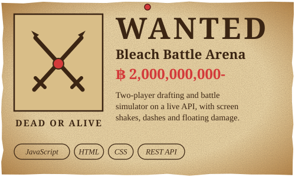
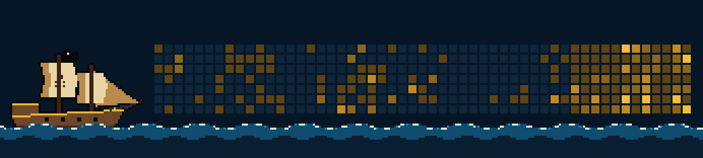

<!-- ══════════════════════════ HEADER ══════════════════════════ -->
<p align="center">
  
</p>

<p align="center">
  <a href="https://injoradev.in">
    
  </a>
</p>

<p align="center">
  <a href="https://www.linkedin.com/in/injora-injora-4b1554346/"></a>
  <a href="https://injoradev.in"></a>
  <a href="mailto:injoraman@gmail.com"></a>
</p>

<p align="center">
  <a href="https://github.com/Injora"></a>
  
</p>

<!-- ══════════════════════════ ABOUT ══════════════════════════ -->
<p align="center"></p>

```js
const pirate = {
  name:        "Injora",
  crew:        "Full-Stack Pirates",
  devilFruit:  "JavaScript",                                 // main language
  haki:        ["React", "Astro", "HTML", "CSS"],            // frontend
  finisher:    "Full-stack apps: React + Node/Express + SQL", // strongest skill
  shipwright:  ["Go", "Django", "PostgreSQL", "MySQL", "MongoDB"],
  alliances:   ["cBioPortal", "Sugar Labs"],                 // merged open-source PRs
  trainingArc: "Mastering Java + Spring Boot",
  nextIsland:  "AI / ML",
  shoreLeave:  ["anime", "movies", "comics"],
  logPose:     "https://injoradev.in",
};
```

<!-- ══════════════════════════ STACK ══════════════════════════ -->
<p align="center"></p>

<table align="center">
  <tr>
    <td align="center"><b>Frontend</b></td>
    <td></td>
  </tr>
  <tr>
    <td align="center"><b>Backend</b></td>
    <td></td>
  </tr>
  <tr>
    <td align="center"><b>Databases</b></td>
    <td></td>
  </tr>
  <tr>
    <td align="center"><b>In Training</b></td>
    <td></td>
  </tr>
  <tr>
    <td align="center"><b>Tools</b></td>
    <td></td>
  </tr>
</table>

<!-- ══════════════════════════ JOURNEY ══════════════════════════ -->
<p align="center"></p>

<p align="center">
  
</p>

<!-- ══════════════════════════ PROJECTS ══════════════════════════ -->
<p align="center"></p>

<p align="center">
  <a href="https://github.com/Injora/RecomOS"></a>
  <a href="https://github.com/Injora/shuttle-tracker"></a>
  <a href="https://github.com/nst-sdc/nst-funds"></a>
  <a href="https://github.com/Injora/Seireitei"></a>
</p>

<p align="center"><sub>Click a poster for the code. Try two of them live: <a href="https://recomos.onrender.com/">OpenSource Compass</a> and <a href="https://seireitei.injoradev.in/">Bleach Battle Arena</a>.</sub></p>

<!-- ══════════════════════════ STATS ══════════════════════════ -->
<p align="center"></p>

<p align="center">
  
  
</p>

<p align="center">
  
</p>

<p align="center">
  
</p>

<!-- ══════════════════════════ CANNON ══════════════════════════ -->
<p align="center"></p>

<p align="center">
  
</p>

<!-- ══════════════════════════ FOOTER ══════════════════════════ -->
<p align="center"></p>

<p align="center">
  
</p>
