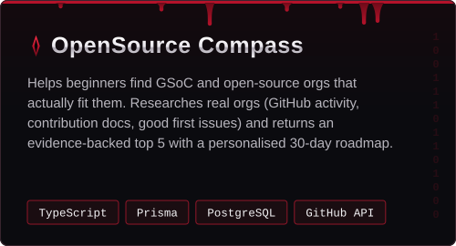
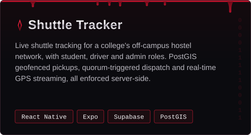
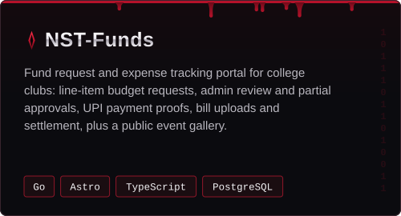
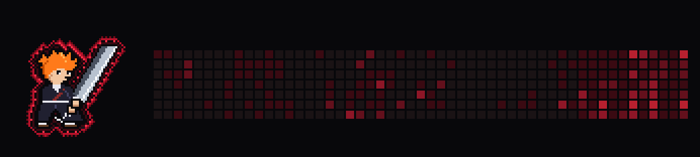

<!-- ══════════════════════════ HEADER ══════════════════════════ -->
<p align="center">
  
</p>

<p align="center">
  <a href="https://injoradev.in">
    
  </a>
</p>

<p align="center">
  <a href="https://www.linkedin.com/in/injora-injora-4b1554346/"></a>
  <a href="https://injoradev.in"></a>
  <a href="mailto:injoraman@gmail.com"></a>
</p>

<p align="center">
  <a href="https://github.com/Injora"></a>
  
</p>

<!-- ══════════════════════════ ABOUT ══════════════════════════ -->
<p align="center"></p>

```js
const soulReaper = {
  name:           "Injora",
  division:       "Full-Stack Division",
  zanpakuto:      "JavaScript",                        // main language
  shikai:         ["React", "Astro", "HTML", "CSS"],   // frontend form
  bankai:         "Full-stack apps: React + Node/Express + SQL", // strongest skill
  kido:           ["Go", "Django", "PostgreSQL", "MySQL", "MongoDB"],
  currentMission: "Mastering Java + Spring Boot",
  offDuty:        ["anime", "movies", "comics"],
  senkaimon:      "https://injoradev.in",
};
```

<!-- ══════════════════════════ STACK ══════════════════════════ -->
<p align="center"></p>

<table align="center">
  <tr>
    <td align="center"><b>Frontend</b></td>
    <td></td>
  </tr>
  <tr>
    <td align="center"><b>Backend</b></td>
    <td></td>
  </tr>
  <tr>
    <td align="center"><b>Databases</b></td>
    <td></td>
  </tr>
  <tr>
    <td align="center"><b>In Training</b></td>
    <td></td>
  </tr>
  <tr>
    <td align="center"><b>Tools</b></td>
    <td></td>
  </tr>
</table>

<!-- ══════════════════════════ PROJECTS ══════════════════════════ -->
<p align="center"></p>

<p align="center">
  <a href="https://github.com/Injora/RecomOS"></a>
  <a href="https://github.com/Injora/shuttle-tracker"></a>
  <a href="https://github.com/nst-sdc/nst-funds"></a>
  <a href="https://github.com/Injora/Seireitei"></a>
</p>

<p align="center"><sub>Click a card for the code. Try two of them live: <a href="https://recomos.onrender.com/">OpenSource Compass</a> and <a href="https://seireitei.injoradev.in/">Bleach Battle Arena</a>.</sub></p>

<!-- ══════════════════════════ STATS ══════════════════════════ -->
<p align="center"></p>

<p align="center">
  
  
</p>

<p align="center">
  
</p>

<p align="center">
  
</p>

<!-- ══════════════════════════ GETSUGA ══════════════════════════ -->
<p align="center"></p>

<p align="center">
  
</p>

<!-- ══════════════════════════ FOOTER ══════════════════════════ -->
<p align="center"></p>

<p align="center">
  
</p>
